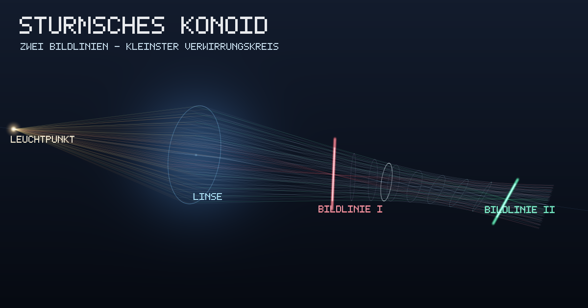

# Sturmsches Konoid – 3D-Demo (three.js)

Interaktive 3D-Visualisierung der **Astigmatismus-Bildzeichnung** eines Achsenpunktes:
ein Leuchtpunkt auf der optischen Achse strahlt durch eine runde, astigmatische
(torische) Sammellinse; hinter der Linse formt das Bündel über die Schar der
Fokalfiguren das **Sturmsche Konoid** und geht durch die **beiden Bildlinien**
(tangential näher und kürzer, sagittal weiter und länger) mit dem
**kleinsten Verwirrungskreis** dazwischen.

Live zum Ausprobieren (baugleich, Handy und Desktop):

* **<https://sturm.optikorakel.de/>** – eigene Domain, Hauptadresse
* **<https://lichtbaendiger.github.io/sturm/>** – GitHub-Pages-Zweig aus diesem Repo



## Inhalt

| Datei | Zweck |
|---|---|
| `index.html` | komplette Anwendung (HTML, CSS, JavaScript in einer Datei); three.js wird vom CDN geladen |
| `vorschau.png` | Vorschaubild 1200 × 630 (exakt 1,91:1) für Social-Media-Karten und diese README |
| `make-preview.mjs` | erzeugt `vorschau.png` aus derselben Optik (`node make-preview.mjs vorschau.png`) |

Eine eigene Kopie von three.js ist nicht im Repository. Wer ohne Internet arbeiten will, legt
`three.module.js` (aus `node_modules/three/build/`) neben `index.html` und ruft den Ordner über
einen lokalen Webserver auf – Browser verbieten es vom Dateisystem aus, lokale Module zu laden.

## Vorschaubild beim Teilen

Teilt jemand den Link, zeigen Facebook, LinkedIn, WhatsApp, X & Co. das Bild, das
über **Open-Graph-Meta-Tags** im Kopf von `index.html` angesprochen wird
(`og:image`, `og:title`, `og:description`, `og:url`, dazu `twitter:card`).
Wichtig:

* Crawler lesen diese Meta-Angaben – ein per CSS verstecktes `` im Körper wird nicht ausgewertet.
* `og:url` und `rel="canonical"` nennen die **Hauptadresse** `https://sturm.optikorakel.de/`;
  geteilte Links zeigen dadurch immer auf die Domain, auch wenn gerade die Pages-Adresse kopiert wurde.
* `og:image` und `twitter:image` zeigen bewusst auf den **Pages-Pfad**
  `https://lichtbaendiger.github.io/sturm/vorschau.png`: der läuft über GitHubs CDN, ist also
  auch erreichbar, falls die eigene Domain einmal umzieht oder abläuft. Beide Adressen bedienen
  dieselbe Datei, jederzeit kann auch die Domain-Variante eingetragen werden.
* Damit die Karte wirklich ein Bild zeigt, muss die Bilddatei **öffentlich erreichbar** sein –
  auf dem Webspace neben `index.html` im Web-Root, bei Pages liegt sie dank dieses Repos schon
  im Wurzelverzeichnis. Fehlt die Datei, bleibt die Karte leer; die Meta-Tags allein reichen nicht.
* Karten rechnen mit etwa 1,91:1 – `vorschau.png` (1200 × 630) passt exakt. Wer lieber ein
  Bildschirmfoto der laufenden Demo zeigen will legt es ins Repo (z. B. 1920 × 1088), passt in
  den Meta-Tags `og:image`, `og:image:width/-height` und `twitter:image` die Datei samt Maß an,
  und schneidet es im Zweifel auf 1,91:1 zu.
* Für das Teilen des **Repo-Links** setzt GitHub ein eigenes Vorschaubild: *Settings → Social preview* → Bild hochladen.
* Prüfen lässt sich das nach dem Deploy mit dem Share-Debugger von Facebook oder dem Twitter/X Card Validator.


## Physik (paraxiales Dünnglas-Modell)

Dioptrien-Matrix der Linse `Φ = diag(ΦT , ΦS)` mit `ΦT > ΦS`, Objektweite `g`:

```
1/b = 1/f − 1/g          f = 1000/Φ[dpt]        (bT < bS)
Schnittfigur bei z:      ax = R·|1 − z/bT| ,  ay = R·|1 − z/bS|
z = bT  →  Bildlinie I   (vertikal, tangential)
z = bS  →  Bildlinie II  (horizontal, sagittal)
1/bK = ½(1/bT + 1/bS)  →  kleinster Verwirrungskreis, r = R·|1 − bK/bT|
```

Der Objektkegel ist geometrisch exakt, die Brechung paraxial — dadurch bleiben
beide Bildlinien scharf definiert, wie in der Lehrbuchzeichnung.

## Bedienung

* **Drehen:** linke Maustaste ziehen (bzw. 1 Finger)
* **Zoomen:** Mausrad (bzw. 2 Finger auseinander/zusammen)
* **Bereich verschieben:** rechte **oder** mittlere Maustaste gedrückt halten und ziehen, alternativ `Shift` + Ziehen (bzw. 2 Finger gemeinsam bewegen)
* **Tasten:** `H` Regler, `W` Messwerte, `Leertaste`/`P` Pause, `R` Licht-Neuaufbau, `F` Ansicht einpassen
* Regler: Brechkraft beider Meridiane, Objektweite, Linsenradius, Strahlenzahl, Photonentempo; Voreinstellungen; Umschalter für Konoidfläche, Fokalfiguren, Bildlinien, Bündel, Meridianebenen, Photonen, Schnittebene, Achse/Raster, Beschriftung, Auto-Drehung

Auf dem Handy werden die Regler und die Messwerte über die untere Knopfleiste
eingeklappt; auf dem Desktop bleibt die Seitenanordnung unverändert.

## Ausführen

1. **Im Browser (Standard):** `index.html` doppelklicken – three.js kommt vom CDN, dafür braucht es Internet.
2. **Lokal mit eigener three.js-Kopie:** `three.module.js` (aus `node_modules/three/build/`) neben
   `index.html` legen, Ordner servieren (`npx serve .`) und `http://localhost:3000/` öffnen.
3. **Online:** <https://sturm.optikorakel.de/> oder <https://lichtbaendiger.github.io/sturm/>

## Veröffentlichen

**GitHub-Pages** baut direkt aus diesem Repo: *Settings → Pages* → Quelle **Deploy from a
branch**, Branch `main`, Ordner `/ (root)` → Save. Da `index.html` und `vorschau.png` schon im
Wurzelverzeichnis liegen, sind keine weiteren Dateien nötig; jeder Push auf `main` ist nach dem
Deployment unter `https://<benutzer>.github.io/<repo>/` erreichbar.

**Eigene Domain** (`sturm.optikorakel.de`): zwei Dateien in den Web-Root hochladen –
`index.html` und `vorschau.png`. three.js laden beide Varianten direkt vom CDN, ein eigener
Ordner dafür ist nicht nötig. Falls das Vorschaubild künftig von der eigenen Domain kommen soll,
in den Meta-Tags `og:image` und `twitter:image` auf
`https://sturm.optikorakel.de/vorschau.png` umstellen.

Nach dem Deploy die Karte testen: Share-Debugger (Facebook) bzw. Card Validator (X) – beide
cachen Vorschaubilder, im Zweifel einmal neu anfragen.
